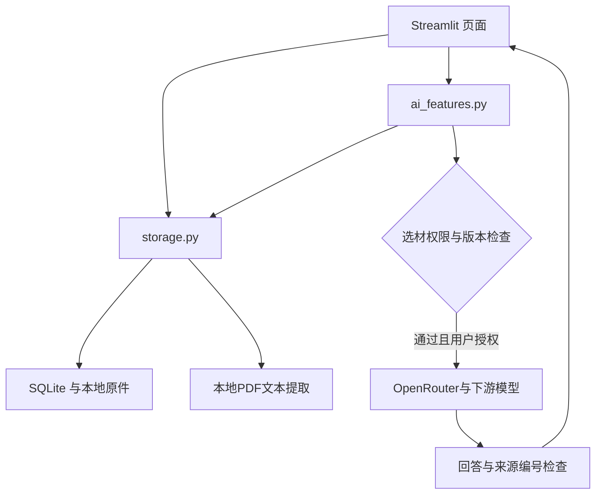

# 架构、数据与隐私

## 模块

没有 FastAPI、向量数据库、Embedding 模型、OCR 或视频转录模块；这些是后续计划，不作为已实现架构展示。

## 数据组织

| 数据 | 保存位置/表 | 用途 |
| --- | --- | --- |
| 收藏原件 | data/files | UUID 文件名保留原始字节 |
| 元数据与备注 | items | 标题、空间、标签、链接、文件名、时间、权限、删除状态、版本与哈希 |
| 提取正文 | extracted_pages | item_id + 文件页/文本段编号 |
| 检索片段 | chunks_v03 | 800 字符块，120 字符重叠，页码与偏移 |
| 今日卡片 | daily_cards | 日期+类型唯一，回答及来源快照 |

迁移为新增字段/表，执行前保留数据库备份。旧数据默认仅本地。编辑和重新提取更新版本并重建分块。

## 检索

英文词、中文双字组合计算词频余弦相关性。匹配文字包括标题、标签和内容；并不是经过语义训练的 embedding。无法保证跨语言或同义表达匹配。按页入口提供可控的查阅路径，但不代表检索质量已经解决。

## 云端边界

只有主动生成时发送问题/指令和所选片段标题、正文、页码；不随请求上传整库或原附件。请求前读取最新数据库，拒绝仅本地、回收站、过期版本或无效分块。

密钥只用于当前会话与请求认证，不写入数据库或日志。软件不额外加密本地原件、数据库和备份。问题框中手动输入的私人文字不会自动脱敏。

云端模型的保留、训练与路由政策需要分别核实，代码不能替第三方保证零留存。取消授权、删除原件不会撤回既往请求。

## 删除与备份

永久删除仅对回收站素材开放。先临时移动原件，数据库失败时尝试恢复，提交成功后清理文件；清理失败时显示待清理文件名。备份与导出不联动删除。SQLite 删除不是法证级安全擦除。

项目应仅在可信本机运行，绑定 127.0.0.1 并关闭 Streamlit 使用统计。未设计用户登录、多租户隔离、公共部署或并发编辑的严格事务权限保证。

## 模型输出

保留 4096 max_tokens；识别 length 截断并阻止作为成功卡片保存。引用检查只确认编号归属、缺失引用和正文网址等格式问题，不验证事实蕴含。输出在显示前转义，避免运行模型生成的 HTML。
