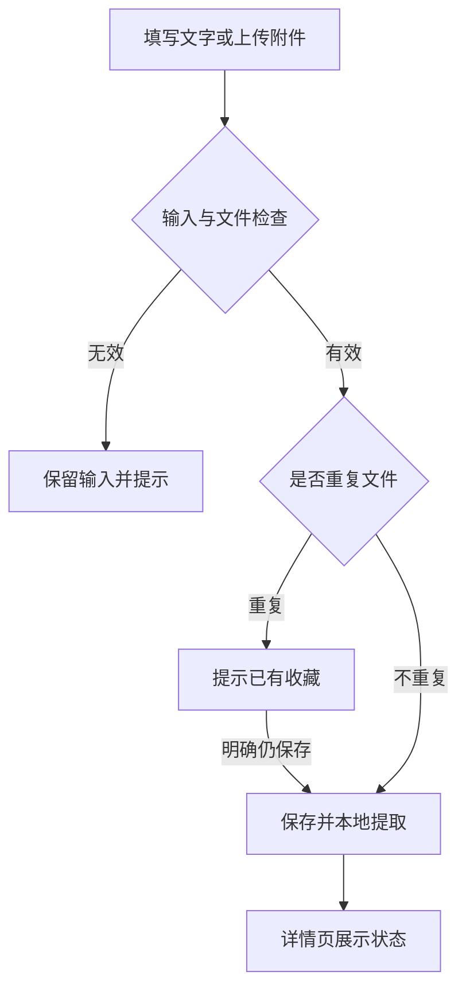
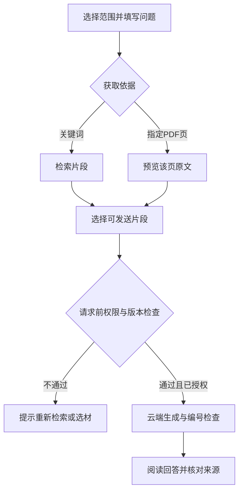

# 页面结构与交互逻辑

## 导航与页面职责

主任务为收藏、问答、每日收获；添加素材和回收站是辅助入口。AI 设置固定在侧边栏折叠区，跨页面保留本次会话输入。

| 页面 | 主操作 | 次操作 | 反馈与异常 |
| --- | --- | --- | --- |
| 收藏库 | 搜索、筛选、打开详情 | 排序与分页 | 无结果提示调整筛选或添加 |
| 添加素材 | 保存 | 分类、标签、权限选择 | 验证失败保留输入；成功跳转详情 |
| 详情 | 阅读、预览、查看提取页 | 编辑、下载、重提取 | 缺件或提取失败明确显示 |
| 问答 | 查找资料，再根据选中片段生成 | 调整范围、指定 PDF 页、导出 | 未授权/无可发片段时禁用；无命中给替代入口 |
| 今日拾得 | 选类型、主题、材料并生成 | 阅读历史、导出 | 已有卡片读取本地；失败不保存为成功 |
| 回收站 | 恢复 | 永久删除及关联卡片处理 | DELETE 确认；范围说明 |

## 添加与整理

新素材默认仅本地。重复判定依据文件内容 SHA-256，不只是文件名。附件提取失败不应等同于原件未保存，状态需区分。

## 问答与 PDF 按页入口

- 本地结果可以包含仅本地素材；它们不出现在可发送选择中。
- 指定 PDF 页不绕过权限，仅绕过关键词匹配。
- 文件页码是物理页序，可能不同于印刷页码。
- 当前最多选择的结果数可设 3/5/8/12；页内容超出该数时有截取提示。
- 问题或范围改变后丢弃旧检索状态；数据库内容改变后请求边界拒绝旧片段。
- AI 答案的实际引用快照与当前候选来源分开保留，避免后续选择变化造成混淆。

## 今日卡片

选择类型 → 若当天该类型已有卡片则本地读取 → 否则按主题或轮换规则选材 → 预览 → 点击生成 → 编号检查 → 保存。

主题为空时优先近期未使用的素材，并按日期轮换素材内片段；它是简单规则，不是个性化训练模型。历史记录为生成时快照，修改原件不会自动重写历史。

## 删除

收藏库“移入回收站”：软删除，排除后续检索，原件保留。

回收站“永久删除”：输入 DELETE → 可选择同时删除引用该素材的历史卡片 → 删除记录、文件及提取分块。默认不删除历史卡片；备份、导出、其他重复收藏均不在范围内。不是磁盘安全擦除。

## 视觉原则与待验证

浅灰背景、绿色主操作、白色卡片；列表强调发现，详情强调阅读，管理操作折叠；答案与证据相邻。模型文本转义后只使用受控基础排版，不执行 HTML 或加载其外链图片。

已验证组件交互，尚未完成多屏幕截图级视觉验收。真实 Windows 浏览器的字号、滚动长度和小屏布局仍需用户反馈。
